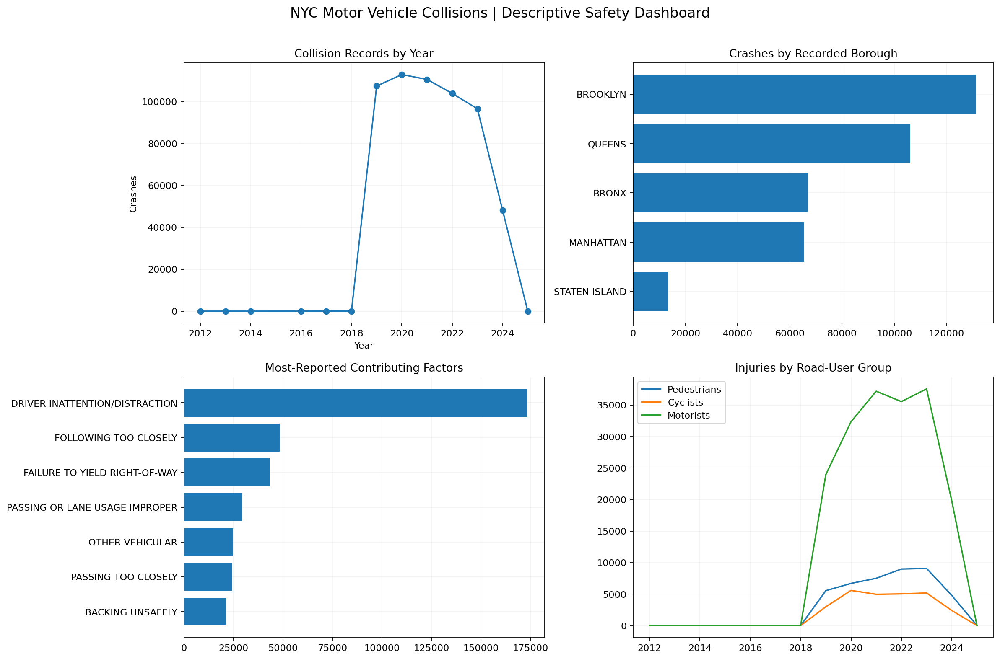

# NYC Traffic Safety — SQL Collision Intelligence

## Business objective
Support NYC road-safety planning with reproducible SQL analysis of crashes, recorded factors, affected road-user groups and locations.

## Executive overview
| Measure | Value |
|---|---:|
| Original source rows | 579,624 |
| Records with valid dates | 579,624 |
| Invalid/missing crash dates | 0 |
| Missing/unknown borough | 196,324 |
| Missing latitude or longitude | 45,885 |
| Source date coverage | 2012-07-27 to 2025-01-07 |
| Most collisions among known boroughs | BROOKLYN |
| Most reported contributing factor | DRIVER INATTENTION/DISTRACTION |

## Annual collision counts
| year | crashes | yoy_pct |
| --- | --- | --- |
| 2012 | 4 | — |
| 2013 | 8 | 100.00 |
| 2014 | 4 | -50.00 |
| 2016 | 13 | 225.00 |
| 2017 | 47 | 261.54 |
| 2018 | 23 | -51.06 |
| 2019 | 107404 | 466873.91 |
| 2020 | 112916 | 5.13 |
| 2021 | 110551 | -2.09 |
| 2022 | 103882 | -6.03 |
| 2023 | 96569 | -7.04 |
| 2024 | 48202 | -50.09 |

**Critical trend caveat:** Dataset coverage begins on 2012-07-27 and ends on 2025-01-07; the first and last years may be partial. Year-over-year differences are descriptive and may reflect reporting completeness or changes. Do not conclude that crashes are rising/falling from unmatched partial years.

## Borough breakdown
| borough | crashes | persons_injured | persons_killed |
| --- | --- | --- | --- |
| UNKNOWN | 196324 | 100291.00 | 651.00 |
| BROOKLYN | 131341 | 58732.00 | 260.00 |
| QUEENS | 106089 | 44586.00 | 196.00 |
| BRONX | 66993 | 28982.00 | 127.00 |
| MANHATTAN | 65341 | 24452.00 | 126.00 |
| STATEN ISLAND | 13536 | 5927.00 | 32.00 |

The counts are **not borough crash rates**. Population, vehicles, trips, or miles traveled are needed for exposure-adjusted comparisons.

## Top streets
| street | borough | crashes |
| --- | --- | --- |
| BELT PARKWAY | UNKNOWN | 8706 |
| LONG ISLAND EXPRESSWAY | UNKNOWN | 5469 |
| BROOKLYN QUEENS EXPRESSWAY | UNKNOWN | 5322 |
| FDR DRIVE | UNKNOWN | 4463 |
| GRAND CENTRAL PKWY | UNKNOWN | 4415 |
| MAJOR DEEGAN EXPRESSWAY | UNKNOWN | 3605 |
| CROSS ISLAND PARKWAY | UNKNOWN | 3513 |
| CROSS BRONX EXPY | UNKNOWN | 3165 |
| VAN WYCK EXPWY | UNKNOWN | 3087 |
| HENRY HUDSON PARKWAY | UNKNOWN | 2338 |

## Top intersections
| borough | on_street | cross_street | crashes |
| --- | --- | --- | --- |
| BRONX | WEST FORDHAM ROAD | MAJOR DEEGAN EXPRESSWAY | 234 |
| UNKNOWN | ROCKAWAY BOULEVARD | BROOKVILLE BOULEVARD | 192 |
| UNKNOWN | BRUCKNER BOULEVARD | EAST 138 STREET | 143 |
| BRONX | BRUCKNER BOULEVARD | LEGGETT AVENUE | 143 |
| UNKNOWN | FLATBUSH AVENUE | GRAND ARMY PLAZA | 142 |
| BRONX | BRUCKNER BOULEVARD | HUNTS POINT AVENUE | 137 |
| UNKNOWN | VANWYCK EXPRESSWAY | LINDEN BOULEVARD | 135 |
| BROOKLYN | PENNSYLVANIA AVENUE | ATLANTIC AVENUE | 132 |
| BRONX | MAJOR DEEGAN EXPRESSWAY | WEST FORDHAM ROAD | 128 |
| BROOKLYN | ATLANTIC AVENUE | LOGAN STREET | 126 |

Street aliases, direction and intersection ordering may split equivalent locations. Check geospatial quality before operational decisions.

## Top contributing factors
| factor | mentions |
| --- | --- |
| DRIVER INATTENTION/DISTRACTION | 173160 |
| FOLLOWING TOO CLOSELY | 48380 |
| FAILURE TO YIELD RIGHT-OF-WAY | 43352 |
| PASSING OR LANE USAGE IMPROPER | 29374 |
| OTHER VEHICULAR | 24852 |
| PASSING TOO CLOSELY | 24194 |
| BACKING UNSAFELY | 21146 |
| UNSAFE SPEED | 20908 |
| TRAFFIC CONTROL DISREGARDED | 16947 |
| UNSAFE LANE CHANGING | 15259 |

Each crash can contain as many as five contributing-factor fields. These totals represent **mentions**, not mutually exclusive collisions or verified causes. Borough comparisons are available in `nyc_borough_factors.csv`.

## Road-user injury and fatality analysis
| borough | pedestrian_injured | pedestrian_killed | cyclist_injured | cyclist_killed | motorist_injured | motorist_killed |
| --- | --- | --- | --- | --- | --- | --- |
| BRONX | 5775.00 | 45.00 | 2287.00 | 16.00 | 19966.00 | 57.00 |
| BROOKLYN | 11073.00 | 130.00 | 7346.00 | 37.00 | 37922.00 | 81.00 |
| MANHATTAN | 6305.00 | 85.00 | 5591.00 | 15.00 | 11577.00 | 22.00 |
| QUEENS | 8110.00 | 91.00 | 3723.00 | 13.00 | 31252.00 | 88.00 |
| STATEN ISLAND | 877.00 | 11.00 | 248.00 | 2.00 | 4747.00 | 18.00 |
| UNKNOWN | 10438.00 | 252.00 | 6918.00 | 39.00 | 80960.00 | 341.00 |

These are affected persons in reported crashes, not probabilities of harm; subgroup risk requires exposure counts. Missing values were converted to zero for summing, and original field completeness is audited.

## Vehicle involvement
| vehicle_group | vehicle_mentions | pct_mentions_in_casualty_crashes |
| --- | --- | --- |
| SEDAN / PASSENGER CAR | 468260 | 32.73 |
| SUV / STATION WAGON | 364501 | 32.16 |
| TRUCK / VAN | 70959 | 23.51 |
| BICYCLE / E-BIKE | 38168 | 82.44 |
| TAXI | 28945 | 37.55 |
| MOTORCYCLE / MOPED | 21787 | 74.32 |
| BUS | 18686 | 24.99 |
| AMBULANCE | 5314 | 13.06 |
| DUMP | 3607 | 23.76 |
| CONVERTIBLE | 2438 | 29.16 |
| FLAT BED | 2328 | 22.64 |
| PK | 2319 | 23.63 |

Vehicle mention counts are not crash counts. A crash may list multiple vehicle groups; a reported casualty crash cannot establish which vehicle caused the harm. Standardization combines examples such as SUVs and station wagons and can be refined.

## Method and SQL implementation
1. Load CSV as strings through DuckDB's `read_csv` SQL scanner to handle large data without loading all raw rows into pandas.
2. Map column variants and parse crash dates using explicit date formats.
3. Build standardized crash, factor and vehicle SQL views.
4. Audit missing geography, invalid dates and duplicate collision IDs.
5. Aggregate annual/monthly, borough, location, factor, injury and vehicle data in SQL.
6. Validate reconciliation of dated crash rows across aggregates.
7. Export report-ready CSVs, dashboard, recommendations and ZIP.

## Data source and access
Input: `Motor_Vehicle_Collisions_-_Crashes.csv`. This file is **not automatically included in the ZIP or GitHub upload** because it may be very large. To reproduce, obtain the original NYPD Motor Vehicle Collisions — Crashes open-data extract and set `DATA_FILE` if the filename differs. An extract's date range and updates may affect results. Publish the raw file separately only when appropriate and consistent with its source terms.

## Technology
Python, DuckDB (SQL), pandas, NumPy, Matplotlib, Google Colab.

## Reproduce
1. Upload `NYC_Traffic_Safety_SQL_Analysis.ipynb` to Google Colab.
2. Upload the NYC collisions CSV to Colab's `/content` or store in Drive and set `DATA_FILE` to the full path.
3. Run cells top-to-bottom. Results will be saved in `/content/NYC_Project7_Outputs`.
4. Download the project ZIP from the final cell. Download `.ipynb` separately and include it in your GitHub repository.
5. On GitHub, create `NYC-Traffic-Safety-Collision-Analytics` at https://github.com/new and upload extracted exports, the notebook, README and recommendations.

## Included outputs
- `nyc_annual_trends.csv`, `nyc_monthly_trends.csv`
- `nyc_borough_summary.csv`, `nyc_top_streets.csv`, `nyc_top_intersections.csv`
- `nyc_contributing_factors.csv`, `nyc_borough_factors.csv`
- `nyc_road_user_by_borough.csv`, `nyc_road_user_by_year.csv`
- `nyc_vehicle_type_summary.csv`, `nyc_data_quality_audit.csv`, `nyc_duplicate_collision_ids_audit.csv`
- `nyc_traffic_safety_dashboard.png`, `RECOMMENDATIONS.md`, `requirements.txt`, `.gitignore`

## Scope limitations and next steps
The source does not establish exposure-adjusted borough or road-user risk. Check coverage at boundaries and duplicate collision IDs. Additional Power BI dashboard development would be a separate deliverable; this release provides a Python dashboard and SQL-backed exported summaries suitable for Power BI.
